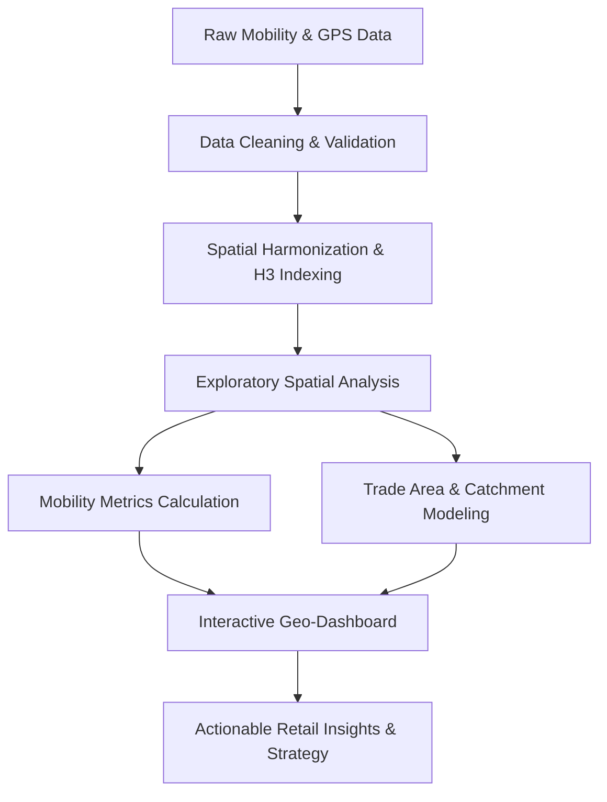

# GeoPulse: Hyper-Local Retail Mobility Analytics

[](https://www.python.org/)
[]()
[]()
[]()
[]()

---

## 📌 Project Overview

**GeoPulse** is an advanced hyper-local retail mobility analytics platform developed as part of the Data Analytics Internship at **Infotact Solutions**. In today’s competitive brick-and-mortar retail landscape, understanding physical customer behavior—such as foot traffic densities, dwell times, visitor origins, and cross-shopping affinity—is crucial for strategic decision-making.

GeoPulse transforms raw spatial coordinates and mobility traces into high-value business intelligence. The platform empowers retail store managers, urban planners, and commercial strategists to optimize store site selection, evaluate trade catchment areas, understand peak operational hours, and enhance customer acquisition.

---

## 🎯 Objectives & Scope of Work

As outlined in the Infotact Solutions Project Assignment Letter (**Ref. No.: ITS/DA/2014**):

1. **Data Ingestion & Cleaning:**
   - Ingest, clean, and validate heterogeneous geospatial and mobility datasets.
   - Handle spatial anomalies, GPS drift, coordinate reference system (CRS) projections, and missing values.

2. **Exploratory Spatial Data Analysis (ESDA):**
   - Identify hyper-local footfall patterns, peak traffic hours, and seasonal visitation trends.
   - Map footfall density across target geographic zones using hexagonal spatial indexing (H3/Uber) and kernel density estimation.

3. **Catchment & Trade Area Modeling:**
   - Delineate primary, secondary, and tertiary retail catchment areas based on customer travel time and distance.
   - Measure store cannibalization and customer overlap between neighboring retail locations.

4. **Customer Behavior & Mobility Metrics:**
   - Calculate key performance indicators (KPIs) including average dwell time, return visitation frequency, and cross-shopping affinities.
   - Cluster consumer mobility segments using unsupervised machine learning.

5. **Interactive Dashboards & Visualization:**
   - Design interactive web-based maps and dashboards (Folium, Kepler.gl, Streamlit) for dynamic scenario exploration.
   - Provide executive-ready reporting and actionable recommendations for business stakeholders.

---

## 🏗️ Repository Architecture

```text
infotact_P2_GeoPulse/
├── data/
│   ├── raw/                # Original, immutable raw data dumps
│   ├── processed/          # Cleaned, transformed, and geocoded datasets
│   └── external/           # Boundary shapefiles, POI lists, and demographic data
├── notebooks/
│   ├── 01_data_ingestion_and_cleaning.ipynb
│   ├── 02_exploratory_spatial_analysis.ipynb
│   ├── 03_mobility_patterns_and_clustering.ipynb
│   └── 04_catchment_and_trade_area_modeling.ipynb
├── src/
│   ├── __init__.py
│   ├── data_loader.py      # Utilities for ingestion and CRS reprojection
│   ├── spatial_features.py # Spatial indexing (H3), distance calculations, buffer zones
│   ├── mobility_metrics.py # Dwell time, visitation frequency, footfall indices
│   └── visualization.py    # Folium / Plotly map generation routines
├── dashboard/
│   ├── app.py              # Streamlit / interactive web application
│   └── components/         # Dashboard UI modules and filters
├── reports/
│   ├── figures/            # Generated charts, maps, and heatmaps
│   └── final_report.pdf    # Comprehensive project documentation
├── presentation/
│   └── GeoPulse_Presentation.pptx
├── requirements.txt        # Python package dependencies
├── .gitignore              # Git ignore rules for data, cache, and env files
└── README.md               # Project documentation and guide
```

---

## ⚙️ Analytical Pipeline & Methodology



### 1. Preprocessing & Quality Assurance
- **Coordinate Standardisation:** Project coordinates to local UTM zones for accurate Euclidean distance calculations.
- **Spatiotemporal Filtering:** Eliminate telemetry noise, teleportation anomalies, and stationary beacon pings.

### 2. Hyper-Local Aggregation
- Discretize continuous spatial space into hexagonal hierarchical bins (Uber H3 grid resolutions 8–10) to aggregate footfall without compromising privacy.

### 3. Retail KPI Computation
- **Footfall Density ($FD$):** Number of unique visitors per square kilometer per hour.
- **Median Dwell Time ($DT$):** Duration spent within store perimeter or point of interest (POI) buffer.
- **Catchment Radius ($R_{80}$):** Radius encompassing 80% of identified customer origins.
- **Affinity Score:** Probability of visiting Store $B$ given a prior visit to Store $A$.

---

## 🛠️ Technology Stack

- **Core Programming:** Python 3.10+
- **Data Manipulation:** `pandas`, `numpy`
- **Geospatial Processing:** `geopandas`, `shapely`, `pyproj`, `h3`, `scipy`
- **Spatial Visualization:** `folium`, `keplergl`, `plotly`, `matplotlib`, `seaborn`
- **Machine Learning:** `scikit-learn` (DBSCAN, K-Means for spatial clustering)
- **Dashboard & Deployment:** `streamlit`, `altair`

---

## 🚀 Getting Started

### Prerequisites
- Python 3.10 or higher
- Git version control installed

### Setup Instructions

1. **Clone the repository:**
   ```bash
   git clone -b akshar https://github.com/akshar059/infotact_P2_GeoPulse.git
   cd infotact_P2_GeoPulse
   ```

2. **Create and activate a virtual environment:**
   ```bash
   # Windows (PowerShell)
   python -m venv venv
   .\venv\Scripts\Activate.ps1

   # Linux / macOS
   python3 -m venv venv
   source venv/bin/activate
   ```

3. **Install dependencies:**
   ```bash
   pip install -r requirements.txt
   ```

4. **Launch the Exploratory Notebooks:**
   ```bash
   jupyter lab
   ```

5. **Run the Interactive Dashboard:**
   ```bash
   streamlit run dashboard/app.py
   ```

---

## 📅 Project Roadmap & Milestones

| Week | Focus Area | Deliverables | Status |
| :---: | :--- | :--- | :---: |
| **Week 1** | Project Setup, Data Ingestion & Cleaning | Environment configuration, raw data validation, coordinate transformations | 🟡 In Progress |
| **Week 2** | Exploratory Spatial Data Analysis | Spatial distribution, foot traffic heatmaps, temporal pattern identification | ⚪ Planned |
| **Week 3** | Mobility Metrics & Catchment Analysis | Dwell time analytics, customer trade area modeling, clustering | ⚪ Planned |
| **Week 4** | Dashboard & Final Presentation | Interactive Streamlit app, PPT, documentation, and executive report | ⚪ Planned |

---

## 👤 Author & Project Metadata

- **Author:** Akshar Patel
- **GitHub:** [@akshar059](https://github.com/akshar059)
- **Role:** Data Associate L1. Intern
- **Organization:** Infotact Solutions
- **Project Ref:** `ITS/DA/2014`
- **Duration:** 10 November 2026 – 10 December 2026
