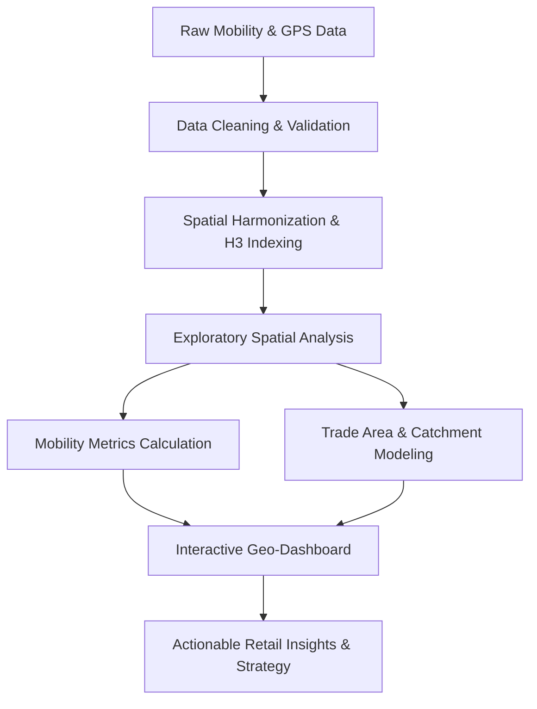

# GeoPulse: Hyper-Local Retail Mobility Analytics

[](https://www.python.org/)
[]()
[]()
[]()
[]()

---

## 📌 Project Overview

**GeoPulse** is an advanced hyper-local retail mobility analytics platform developed as part of the Data Analytics Internship at **Infotact Solutions**. In today’s competitive brick-and-mortar retail landscape, understanding physical customer behavior—such as foot traffic densities, dwell times, visitor origins, and cross-shopping affinity—is crucial for strategic decision-making.

GeoPulse transforms raw spatial coordinates and mobility traces into high-value business intelligence. The platform empowers retail store managers, urban planners, and commercial strategists to optimize store site selection, evaluate trade catchment areas, understand peak operational hours, and enhance customer acquisition.

---

## 🎯 Objectives & Scope of Work

As outlined in the Infotact Solutions Project Assignment Letter (**Ref. No.: ITS/DA/2014**):

1. **Data Ingestion & Cleaning:**
   - Ingest, clean, and validate heterogeneous geospatial and mobility datasets.
   - Handle spatial anomalies, GPS drift, coordinate reference system (CRS) projections, and missing values.

2. **Exploratory Spatial Data Analysis (ESDA):**
   - Identify hyper-local footfall patterns, peak traffic hours, and seasonal visitation trends.
   - Map footfall density across target geographic zones using hexagonal spatial indexing (H3/Uber) and kernel density estimation.

3. **Catchment & Trade Area Modeling:**
   - Delineate primary, secondary, and tertiary retail catchment areas based on customer travel time and distance.
   - Measure store cannibalization and customer overlap between neighboring retail locations.

4. **Customer Behavior & Mobility Metrics:**
   - Calculate key performance indicators (KPIs) including average dwell time, return visitation frequency, and cross-shopping affinities.
   - Cluster consumer mobility segments using unsupervised machine learning.

5. **Interactive Dashboards & Visualization:**
   - Design interactive web-based maps and dashboards (Folium, Kepler.gl, Streamlit) for dynamic scenario exploration.
   - Provide executive-ready reporting and actionable recommendations for business stakeholders.

---

## 🏗️ Repository Architecture

```text
infotact_P2_GeoPulse/
├── data/
│   ├── raw/                # Original, immutable raw data dumps
│   ├── processed/          # Cleaned, transformed, and geocoded datasets
│   └── external/           # Boundary shapefiles, POI lists, and demographic data
├── notebooks/
│   ├── 01_data_ingestion_and_cleaning.ipynb
│   ├── 02_exploratory_spatial_analysis.ipynb
│   ├── 03_mobility_patterns_and_clustering.ipynb
│   └── 04_catchment_and_trade_area_modeling.ipynb
├── src/
│   ├── __init__.py
│   ├── data_loader.py      # Utilities for ingestion and CRS reprojection
│   ├── spatial_features.py # Spatial indexing (H3), distance calculations, buffer zones
│   ├── mobility_metrics.py # Dwell time, visitation frequency, footfall indices
│   └── visualization.py    # Folium / Plotly map generation routines
├── dashboard/
│   ├── app.py              # Streamlit / interactive web application
│   └── components/         # Dashboard UI modules and filters
├── reports/
│   ├── figures/            # Generated charts, maps, and heatmaps
│   └── final_report.pdf    # Comprehensive project documentation
├── presentation/
│   └── GeoPulse_Presentation.pptx
├── requirements.txt        # Python package dependencies
├── .gitignore              # Git ignore rules for data, cache, and env files
└── README.md               # Project documentation and guide
```

---

## ⚙️ Analytical Pipeline & Methodology



### 1. Preprocessing & Quality Assurance
- **Coordinate Standardisation:** Project coordinates to local UTM zones for accurate Euclidean distance calculations.
- **Spatiotemporal Filtering:** Eliminate telemetry noise, teleportation anomalies, and stationary beacon pings.

### 2. Hyper-Local Aggregation
- Discretize continuous spatial space into hexagonal hierarchical bins (Uber H3 grid resolutions 8–10) to aggregate footfall without compromising privacy.

### 3. Retail KPI Computation
- **Footfall Density ($FD$):** Number of unique visitors per square kilometer per hour.
- **Median Dwell Time ($DT$):** Duration spent within store perimeter or point of interest (POI) buffer.
- **Catchment Radius ($R_{80}$):** Radius encompassing 80% of identified customer origins.
- **Affinity Score:** Probability of visiting Store $B$ given a prior visit to Store $A$.

---

## 📊 Data Schema & Dictionary

The analytical pipeline processes anonymized hyper-local mobility pings and retail Point of Interest (POI) metadata using the standardized schema below:

| Column Name | Data Type | Description | Example |
| :--- | :--- | :--- | :--- |
| `ping_id` | `string` | Unique identifier for each recorded location ping | `PNG_982341` |
| `device_hash` | `string` | Anonymized, privacy-compliant visitor device identifier | `a8f3d91c...` |
| `timestamp` | `datetime` | UTC/Local ISO-8601 timestamp of the location observation | `2026-11-11T10:30:00Z` |
| `latitude` | `float64` | WGS84 geographic latitude of the observation | `12.84521` |
| `longitude` | `float64` | WGS84 geographic longitude of the observation | `77.66017` |
| `horizontal_accuracy` | `float32` | Estimated GPS accuracy radius in meters | `12.5` |
| `poi_id` | `string` | Matched retail Point of Interest identifier | `POI_BLR_042` |
| `poi_category` | `string` | Retail vertical classification (e.g., Grocery, Apparel, Cafe) | `Specialty Retail` |
| `h3_index` | `string` | Uber H3 hexagonal spatial grid index (Resolution 9) | `8961892416fffff` |
| `dwell_time_sec` | `int32` | Calculated stay duration within the store geofence (seconds) | `940` |

---

## 🧹 Data Quality & Validation Rules

To guarantee accurate footfall and dwell-time analytics, every ingested mobility dataset passes through automated validation checks:

- **Coordinate Boundary Checks:** Drop observations with out-of-range latitude (`[-90, 90]`), longitude (`[-180, 180]`), or null `0.0, 0.0` coordinates.
- **GPS Accuracy Thresholding:** Filter out low-precision location pings where `horizontal_accuracy > 50` meters to prevent cross-store misattribution.
- **Temporal Deduplication:** Remove duplicate `(device_hash, timestamp)` observations generated by redundant SDK pings within a 5-second window.
- **Teleportation & Velocity Filtering:** Flag and exclude improbable spatial jumps between consecutive device pings exceeding realistic urban travel speeds (`> 120 km/h`).
- **Dwell Time Sanity Bounds:** Require a minimum geofence stay of `120 seconds` to filter out passive passersby and cap extreme outliers (`> 6 hours`) caused by stationary overnight devices.

---

## 📐 Feature Engineering & Spatial Feature Extraction

To transform filtered mobility pings into predictive and analytical signals, the feature engineering pipeline constructs three tiers of attributes:

### 1. Multi-Resolution Hexagonal Spatial Indexing (Uber H3)
- **H3 Resolution 8 (~460m edge length):** Used for macro-catchment trade zones and inter-district commuter traffic analysis.
- **H3 Resolution 9 (~174m edge length):** Primary spatial resolution for store trade area delineation, retail cluster density, and competitor proximity.
- **H3 Resolution 10 (~66m edge length):** Micro-spatial resolution for storefront geofencing, curb-level footfall density, and entrance attribution.

### 2. Cyclical Temporal Encodings
- **Hour-of-Day Encodings:** Transform continuous hours $h \in [0, 23]$ into sinusoidal coordinate pairs:
  $$\text{hour\_sin} = \sin\left(\frac{2\pi \cdot h}{24}\right), \quad \text{hour\_cos} = \cos\left(\frac{2\pi \cdot h}{24}\right)$$
- **Day-of-Week Segmentation:** Binary indicators for weekdays vs. weekends and retail peak shopping windows (Lunch Rush: 12:00–14:00; Evening Surge: 18:00–21:00).

### 3. Visitor Mobility Behavioral Vectors
- **Repeat Visitation Ratio:** Proportion of repeat device hashes observed over a rolling 30-day window.
- **Cross-Category Transition Probability:** Likelihood of a visitor transitioning from a food & beverage POI to an apparel or grocery store within 90 minutes.

---

## 🗺️ Exploratory Spatial Data Analysis (ESDA) Framework

The exploratory phase systematically detects foot-traffic patterns, retail corridors, and spatial dependency:

### 1. Spatial Autocorrelation & Hotspot Detection
- **Global Moran’s $I$:** Formulate spatial weight matrices $W$ (Queen contiguity and $k$-nearest neighbors) to test whether store footfall exhibits statistically significant spatial clustering:
  $$I = \frac{N}{\sum_{i}\sum_{j}w_{ij}} \frac{\sum_{i}\sum_{j}w_{ij}(x_i - \bar{x})(x_j - \bar{x})}{\sum_{i}(x_i - \bar{x})^2}$$
- **LISA (Local Indicators of Spatial Association):** Isolate High-High commercial hotspots (high-traffic zones adjacent to busy retail corridors) and Low-High outliers (underperforming stores bordered by active hubs).

### 2. Kernel Density Estimation (KDE) & Isochrone Mapping
- Compute continuous surface densities across retail corridors with adaptive Gaussian bandwidths.
- Calculate 5-, 10-, and 15-minute pedestrian and vehicular isochrones around flagship retail POIs to map true walkability access sheds.

### 3. Co-Visitation Network & Store Affinity Matrix
- Construct a weighted bipartite graph connecting retail destinations via shared customer device paths to evaluate cross-store synergy and co-shopping frequency.

---

## 💡 Target Business Use Cases

- **Site Selection & Expansion:** Evaluate footfall potential and demographic fit before leasing new retail locations.
- **Peak Staffing & Operations:** Align store associate scheduling with hourly and day-of-week visitor traffic surges.
- **Competitor & Cannibalization Analysis:** Quantify shared visitor overlap across nearby competing stores or sister branches.
- **Hyper-Local Campaign Attribution:** Measure uplift in store visits following localized out-of-home (OOH) or digital promotions.

---

## 🛠️ Technology Stack

- **Core Programming:** Python 3.10+
- **Data Manipulation:** `pandas`, `numpy`
- **Geospatial Processing:** `geopandas`, `shapely`, `pyproj`, `h3`, `scipy`
- **Spatial Visualization:** `folium`, `keplergl`, `plotly`, `matplotlib`, `seaborn`
- **Machine Learning:** `scikit-learn` (DBSCAN, K-Means for spatial clustering)
- **Dashboard & Deployment:** `streamlit`, `altair`

---

## 🚀 Getting Started

### Prerequisites
- Python 3.10 or higher
- Git version control installed

### Setup Instructions

1. **Clone the repository:**
   ```bash
   git clone -b akshar https://github.com/akshar059/infotact_P2_GeoPulse.git
   cd infotact_P2_GeoPulse
   ```

2. **Create and activate a virtual environment:**
   ```bash
   # Windows (PowerShell)
   python -m venv venv
   .\venv\Scripts\Activate.ps1

   # Linux / macOS
   python3 -m venv venv
   source venv/bin/activate
   ```

3. **Install dependencies:**
   ```bash
   pip install -r requirements.txt
   ```

4. **Launch the Exploratory Notebooks:**
   ```bash
   jupyter lab
   ```

5. **Run the Interactive Dashboard:**
   ```bash
   streamlit run dashboard/app.py
   ```

---

## 📅 Project Roadmap & Milestones

| Week | Focus Area | Deliverables | Status |
| :---: | :--- | :--- | :---: |
| **Week 1** | Project Setup, Data Ingestion & Cleaning | Environment configuration, raw data validation, coordinate transformations | 🟡 In Progress |
| **Week 2** | Exploratory Spatial Data Analysis | Spatial distribution, foot traffic heatmaps, temporal pattern identification | ⚪ Planned |
| **Week 3** | Mobility Metrics & Catchment Analysis | Dwell time analytics, customer trade area modeling, clustering | ⚪ Planned |
| **Week 4** | Dashboard & Final Presentation | Interactive Streamlit app, PPT, documentation, and executive report | ⚪ Planned |

---

## 📈 Daily Progress Log

- **Day 1 (10 Nov 2026):** Repository initialization on `akshar` branch; added project overview, objectives, directory architecture, analytical pipeline, technology stack, and 4-week milestone roadmap.
- **Day 2 (11 Nov 2026):** Defined standardized mobility data schema and data dictionary (`ping_id`, `device_hash`, `h3_index`, `dwell_time_sec`) and documented core retail business use cases.
- **Day 3 (12 Nov 2026):** Specified geospatial data quality and validation rules (GPS accuracy thresholding, deduplication, velocity filtering, and dwell time bounds).
- **Day 4 (13 Nov 2026):** Formulated spatial feature extraction protocol (multi-resolution H3 hexagonal indexing, cyclical temporal encodings, and mobility behavioral vectors).
- **Day 5 (14 Nov 2026):** Designed Exploratory Spatial Data Analysis (ESDA) framework including Moran's I spatial clustering, KDE heatmaps, and co-visitation graph metrics.

---

## 👤 Author & Project Metadata

- **Author:** Akshar Patel
- **GitHub:** [@akshar059](https://github.com/akshar059)
- **Role:** Data Associate L1. Intern
- **Organization:** Infotact Solutions
- **Project Ref:** `ITS/DA/2014`
- **Duration:** 10 November 2026 – 10 December 2026
